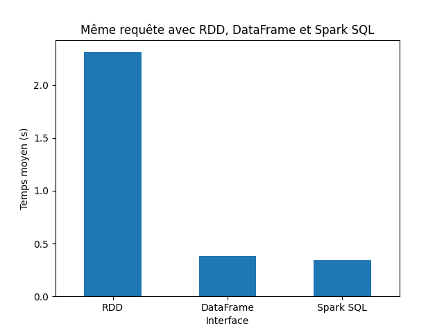

# TP2 : Analyse Big Data des accidents de la route avec PySpark

Ce TP reprend l'article de Rakesh Nain, *Big data Analysis of Road Crash Data using PySpark*. Il analyse les accidents de la route en **Australie-Méridionale entre 2012 et 2019** (données du DPTI) avec les trois interfaces de Spark : **RDD**, **DataFrame** et **Spark SQL**.

## Contenu du dépôt

| Fichier | Description |
|---|---|
| `etudedecas.ipynb` | Notebook complet de l'étude |
| `severe.png` | Nombre d'accidents par gravité, selon l'alcool et les drogues |
| `severe_per.png` | Même comparaison, en pourcentages |
| `comparaison_interfaces.png` | Temps d'exécution d'une même requête avec RDD, DataFrame et Spark SQL |

## Données

- `crash_data` : une ligne par accident (**127 672 accidents**) ;
- `units_data` : une ligne par véhicule impliqué (**272 591 véhicules**).

Les deux jeux sont reliés par la colonne `REPORT_ID`. Les fichiers de données ne sont pas inclus dans ce dépôt : pour exécuter le notebook, placer les CSV dans les dossiers `crash_data/` et `units_data/`, à côté du notebook.

## Ce que contient l'étude

1. **RDD** : partitionnement (par défaut et personnalisé), âge moyen des conducteurs selon le sexe, véhicules les plus anciens et les plus récents.
2. **DataFrames** : accidents à Adélaïde, accidents les plus graves, décès par type d'accident, victimes quand le conducteur n'a pas de permis, gravité selon l'alcool et les drogues.
3. **Comparaison RDD / DataFrame / Spark SQL** sur les mêmes requêtes.

**Deux améliorations par rapport au code d'origine :**
- lecture des lignes CSV avec le module `csv` au lieu de `split(',')`, qui coupait mal les champs contenant une virgule ;
- une même requête écrite avec les trois interfaces, avec vérification que les résultats sont identiques et mesure des temps.

## Principaux résultats

- Les accidents les plus mortels sont les **collisions avec un obstacle fixe** (245 décès) et les **chocs frontaux** (136).
- Sans alcool ni drogues, **0,4 %** des accidents sont mortels ; ce taux monte à **3,4 %** avec l'alcool, **6,3 %** avec les drogues et **13,1 %** avec les deux.
- Les trois interfaces donnent le même résultat, mais les **DataFrames (0,39 s)** et **Spark SQL (0,35 s)** sont environ **6 fois plus rapides** que les **RDD (2,31 s)**, grâce à l'optimiseur Catalyst.

## Exécution

- Installer PySpark : `pip install pyspark` (Java est nécessaire).
- Placer les données dans `crash_data/` et `units_data/`, puis exécuter `etudedecas.ipynb`.

Spark tourne ici en mode local (calcul parallèle sur les cœurs d'une seule machine). Le même code fonctionnerait sur un cluster pour des volumes plus importants.
